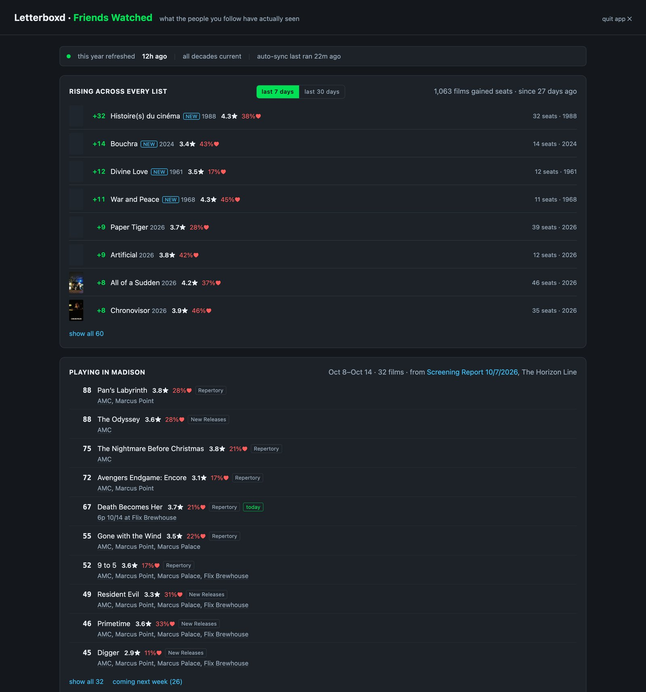
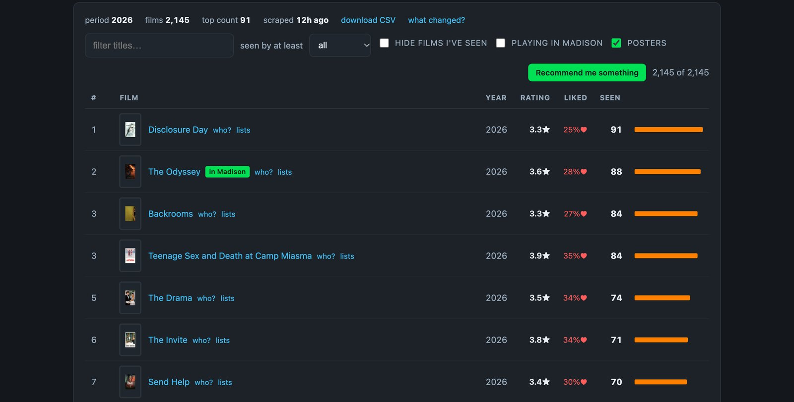
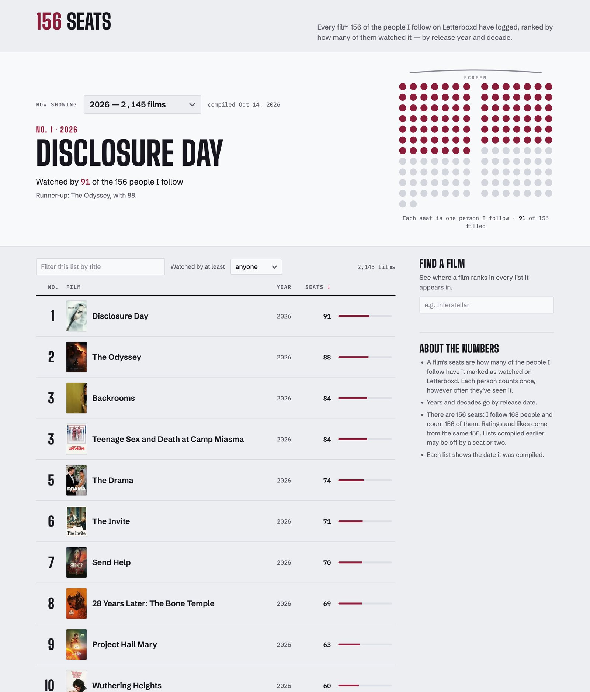

# Letterboxd Friends

[](https://github.com/zacksifakis/letterboxd-friends/actions/workflows/tests.yml)

**Live page:** [156 Seats](https://claude.ai/artifact/Fr6ihpLXsEDhyJCX2qXTVJ) · [Greek edition](https://claude.ai/artifact/Vv3WnrfMcULgqBWhdoimvM)

*I grew up in video rental stores, back when picking a movie meant reading the backs of boxes and asking whoever was behind the counter what was good. Those stores are mostly gone, and the recommendations with them. This project is my attempt to bring a little of that back: what are the people whose taste I trust actually watching, and loving?*

A personal project: for every year and decade of film, how many of the people I
follow on Letterboxd have seen each movie — plus what they thought of it, what's
rising, and what's playing in my city this week. It runs on my Mac as a small
native app, keeps itself up to date in the background, and publishes a public
summary page (with a Greek edition).

Letterboxd shows "watched by N friends" one film at a time. This answers the
questions you can't ask it directly: *what are the 50 most-watched 1970s films
among my friends? which new releases are they actually loving? which films is
everyone talking about right now — and which of them are playing in town this week?*



## What it does

- **Counts, per year and per decade** — every film the people I follow have
  logged, with how many of them watched it, their average rating (half-star
  precision) and the share who liked it.
- **A native macOS app** (Swift + WebKit around a local Python server): sortable
  lists with posters, film and director/actor search, "who watched it" with each
  person's rating, liked lists containing a film, and a one-click
  **"Recommend me something"** (unseen by me, rated by 10+ friends, best first).
- **What changed** — since the last scrape, over 7 days or 30 days, from dated
  snapshots, plus a **Rising** view across every list at once.
- **Local screenings** — parses a weekly local film newsletter, matches its films
  to Letterboxd (following renames and catching mislinked entries), drops
  screenings once their showtime has passed, and links each venue to that
  film's page at the theater.
- **Two published pages** — English and Greek (Greek release titles checked
  against athinorama.gr, filmy.gr and IMDb; cast and genres from Wikidata and Letterboxd), with posters for the top of every list, compressed to
  fit a 16 MB page limit (8.7 MB of data → 3.7 MB, decompressed in the browser).
- **Excluding people** — anyone can be left out of every count; it's a recount
  of stored per-person data, not a re-scrape, and it survives username changes.

<p align="center">
  
  
</p>

## How it stays correct

Most of the work went into making the numbers trustworthy without me watching:

- **A run that can't see everyone never overwrites good data.** Failed fetches
  are retried; stragglers fall back to their last known list; if too many fail,
  or the friends list itself comes back short, the run stops and leaves the
  existing data untouched.
- **A self-check every hour** — that requests still get through, runs used the
  whole friends list, nothing is overdue, no list has shrunk, posters are
  readable, local listings are current — with a macOS notification for new
  serious problems.
- **Freshness by age, not by timer.** An hourly check refreshes whatever is due
  (this year and last daily, each decade every 14 days), so sleep, restarts and
  missed runs simply catch up on wake.
- **Renamed accounts are recognised** by matching film lists, so an exclusion
  follows the person, not the username.

## How it was built

This was built with [Claude Code](https://claude.com/claude-code) as a pair
programmer, and the code is largely AI-written. My part was the product: what it
should do and how it should behave, where the data comes from (including the
local film newsletter), and testing it against reality.

Every feature started as my idea: counting by year and decade; search by film,
director or actor; a real Mac app that keeps itself up to date; posters; what
changed since the last scrape, and over a week or a month; what's rising across
every list; one-click recommendations; friends' own ratings
and likes instead of Letterboxd's averages; excluding accounts; local screenings
from a weekly film newsletter, with links to each theater; and the Greek edition.

Most of the reliability work above started with me noticing a number that didn't
match Letterboxd and tracing why:

- *The Odyssey* showed 91 friends instead of 94 — a scrape that had quietly lost
  three people had overwritten good data. Runs now retry, fall back to the last
  known list, or refuse to write at all.
- Nearly every new film gained a seat overnight — someone I'd excluded had
  changed their username and was being counted again. Exclusions now follow the
  person, not the name.
- A film was missing its "playing in town" badge — the newsletter had linked a
  different film. Titles are now checked against the films they link to.
- Chasing why the published page hadn't updated turned up a decade that had
  shrunk to a tenth of its films — a run had seen only one of the people I
  follow. A short friends list now stops the run.

It's also been a close look at where AI coding is strong, and where it needs a
person checking its work against the real world.

## Layout

| File | Role |
|---|---|
| `letterboxd_friends_v2.py` | the scraper: one period → counts, ratings, likes, per-person data |
| `letterboxd_refresh.py`, `letterboxd_tick.py` | refreshing, scheduling, catching up |
| `letterboxd_selfcheck.py` | the hourly health checks |
| `letterboxd_app.py` | the local server behind the app |
| `ui/` | the app's interface: `index.html`, `app.css`, `app.js` |
| `mac/main.swift` | the native macOS shell |
| `letterboxd_publish.py`, `letterboxd_publish_el.py` | the English and Greek pages |
| `letterboxd_posters.py`, `letterboxd_filmpages.py`, `letterboxd_wikidata.py` | posters, genres, Greek titles, film details |
| `letterboxd_pagefilms.py` | films on any web page (a cinema's programme, a festival lineup) matched to Letterboxd |
| `letterboxd_greek_titles.py` | Greek release titles, checked against athinorama.gr, filmy.gr and IMDb |
| `letterboxd_people.py` | exclusions and recounts |
| `letterboxd_history.py` | dated snapshots for week/month comparisons |
| `letterboxd_net.py` | how requests are made |
| `letterboxd_settings.py` | your username, read from a local file outside the repo |
| `launchd/` | the background job definition |
| `tests/` | tests for the subtle parts — tie-aware cuts, exclusions, renames, snapshots, the newsletter parser, showtimes |

## Running it

```bash
pip install -r requirements.txt
mkdir -p ~/.letterboxd_cache
cp settings.example.json ~/.letterboxd_cache/settings.json   # then put your username in it
python3 letterboxd_friends_v2.py 2026                        # one year…
python3 letterboxd_friends_v2.py 1990s                       # …or a decade
python3 letterboxd_app.py                                    # the interface, on 127.0.0.1:8765
```

Results are written to your home folder (`~/friends_watched_*.csv`), with caches
and your settings in `~/.letterboxd_cache/`, so the project folder holds only code.

Tests run on made-up data and need no network:

```bash
python3 -m unittest discover tests
```

## A note on scraping

This reads public Letterboxd pages. Letterboxd's terms don't permit automated
access, so this is a personal, non-commercial project: it paces its requests and
stops cleanly when they're refused. The published pages show only aggregate
counts — no usernames and no individual activity. The MIT license covers the
code; using it is still subject to Letterboxd's terms.

## License

MIT — see [LICENSE](LICENSE).
